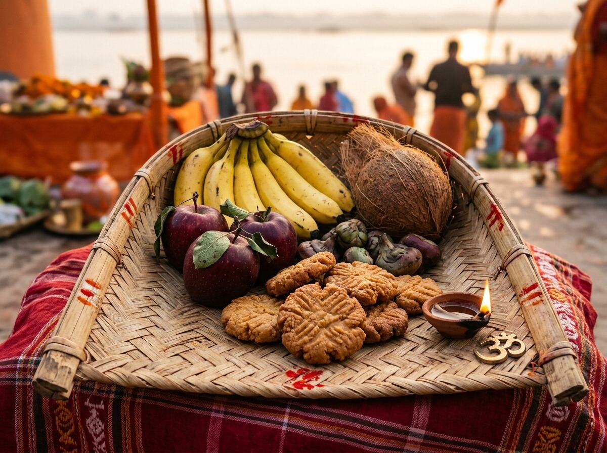
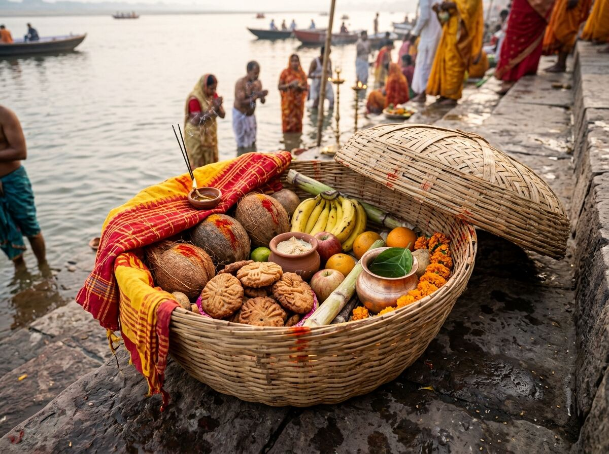
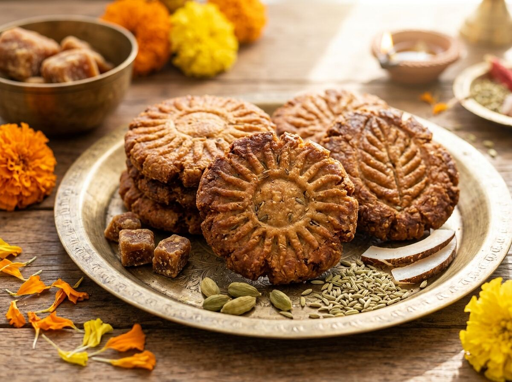
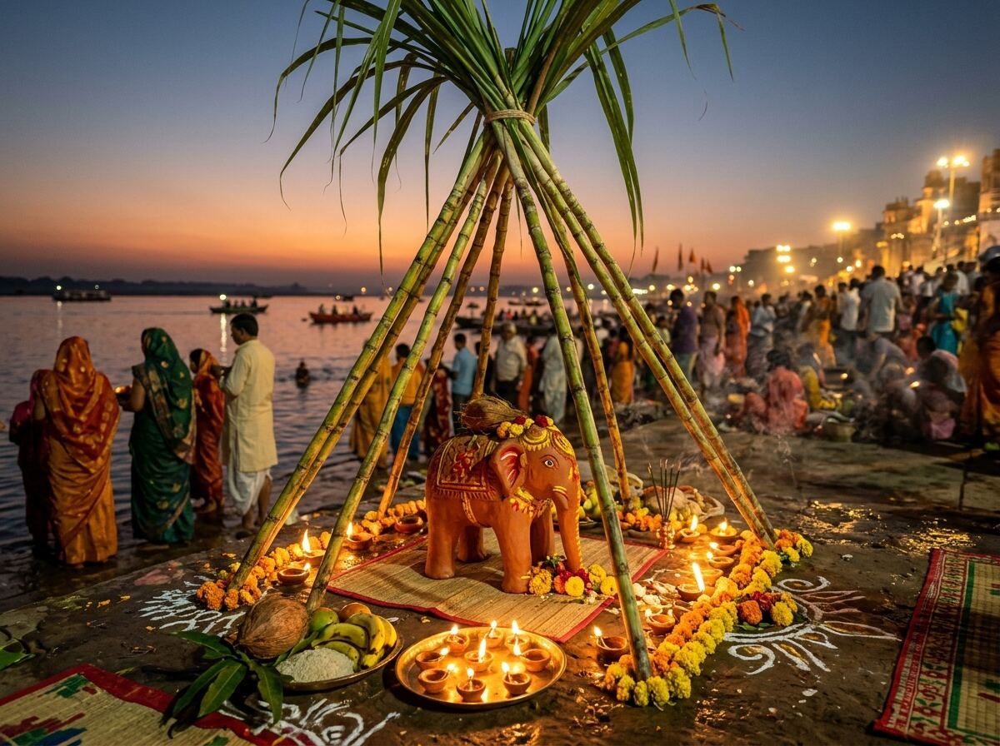
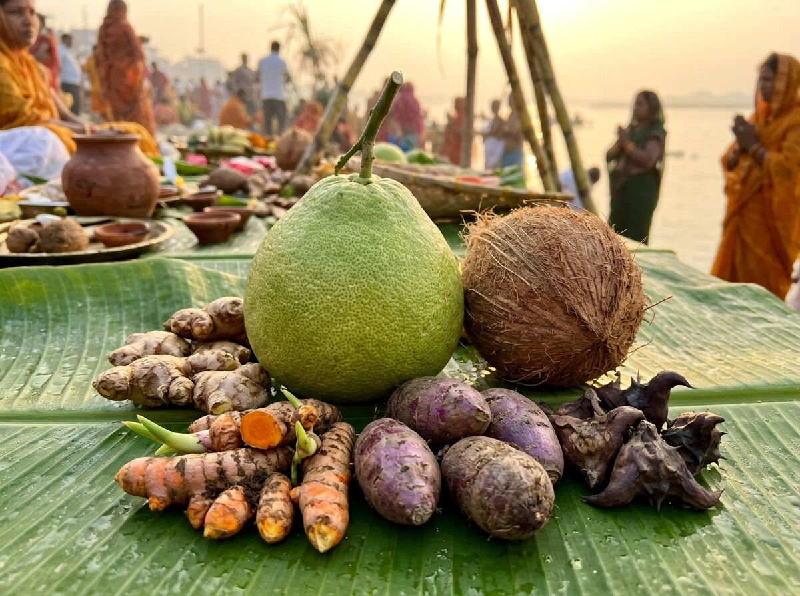
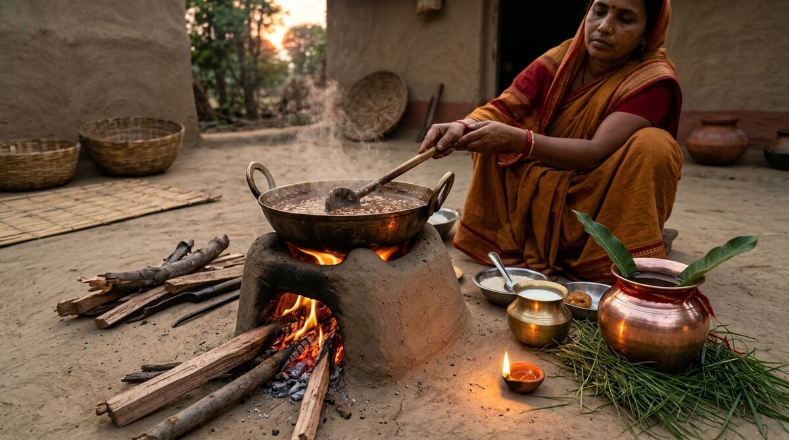
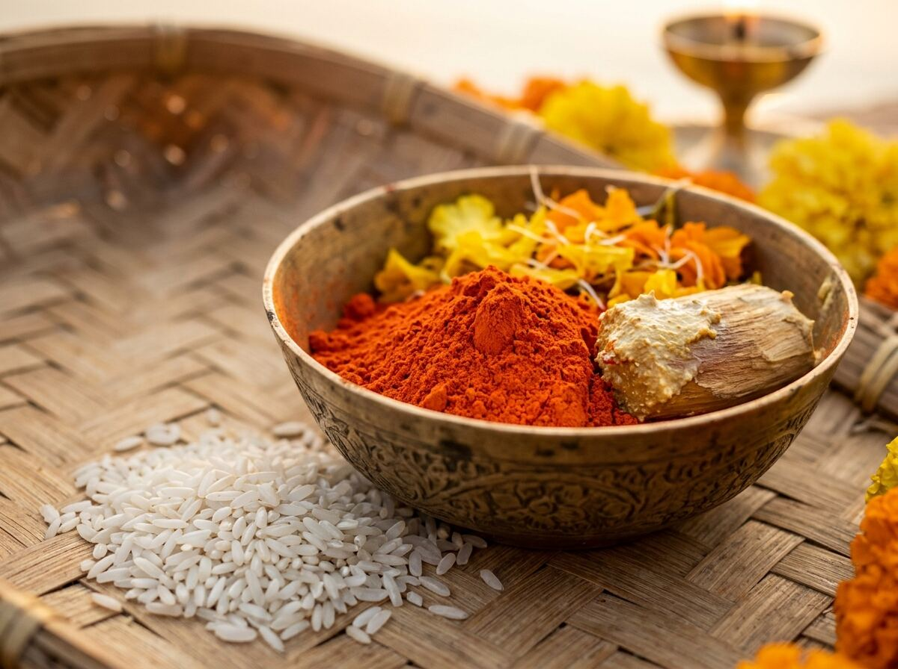
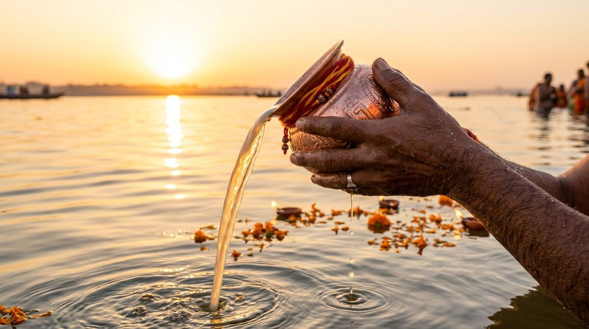

# ChhathMahaparv.org (chhathpooja-global) — Keeping Chhath Alive Everywhere

A free, community-owned, ad-free, open-source digital sanctuary built for the **150+ million devotees** celebrating Chhath across Bihar, Jharkhand, Eastern Uttar Pradesh, the Terai of Nepal, and the global diaspora from London and New Jersey to Dubai, Toronto, and Sydney.

Chhath is the world's most egalitarian, eco-friendly Vedic solar festival:
- **No middleman priests (pandits)** — direct communion between the seeker and Nature.
- **No social hierarchy** — kings and workers stand shoulder-to-shoulder in the same water.
- **Worshipping both Sunset and Sunrise** — honoring the setting sun (gratitude for past cycle) before welcoming the rising sun (hope for future cycle).

---

## 🌟 What This Project Does

- **Dates you can trust**: Kartik + Chaiti Chhath dates (2025–2035) verified by human researchers from DrikPanchang. Zero AI or algorithmic guesswork.
- **Arghya time for your city**: Accurate sunrise (Usha) and sunset (Sandhya) times for Patna, Delhi, Mumbai, Kolkata, Janakpur, Kathmandu, London, New Jersey, Dubai, Sydney, and any GPS coordinate.
- **Solar Sun Compass**: An interactive azimuth compass showing you exactly which direction to face for Sandhya and Usha Arghya from anywhere in the world.
- **Offline-First Vidhi Guide**: 4-day checklist that stays saved locally on your phone even when standing knee-deep in river water with 0 bars of cellular signal.
- **Global Ghat Finder**: Interactive OpenStreetMap tracking verified Chhath ghats worldwide with amenities (lighting, parking, clean water, safety).
- **Curated Folk Music Archive**: 26+ timeless Chhath songs (Sharda Sinha, Anuradha Paudwal, Bharat Sharma Vyas) with legal YouTube embeds, lyrics, and English translations.
- **5 Native Mother Tongues**: English, Hindi, Bhojpuri (भोजपुरी), Maithili (मैथिली), and Nepali (नेपाली).
- **Zero Ads, Zero Tracking, Zero Login**: 100% MIT open-source software built for public service.

---

## 🪔 How to Start Chhath Puja for Beginners (The Zero-Anxiety Guide)

Many young devotees and diaspora families feel intimidated by the strictness of Chhath. But Chhath is rooted in ***Bhav* (devotion)** and ***Shraddha* (reverence)**, not fear.

### 3 Core Beginner Principles
1. **Start as a "Saha-Vrati" (Sacred Helper)**: You do not need to take the 36-hour waterless fast on year one. Begin by helping clean the kitchen, carrying the Daura, kneading thekua dough, or offering Arghya with elders.
2. **Intent > Perfection**: If you don't know traditional Bhojpuri songs or drop a piece of fruit, stay calm. Surya Dev is the cosmic father and Chhathi Maiya is a loving mother. Cleanliness and love are all that are required.
3. **100% Eco-Friendly**: Never use single-use plastic. Use bamboo soops, earthenware, pure cotton, seasonal fruits, and leave water bodies cleaner than you found them.

### Step-by-Step 4-Day Beginner Roadmap

```
Day 1: Nahay-Khay         Day 2: Kharna            Day 3: Sandhya Arghya      Day 4: Usha Arghya & Parana
(Cleanse & Lauki-Bhaat) → (Day Fast & Rasiya Kheer) → (Sunset Ghat Offering) → (Sunrise Arghya & Feast)
```

1. **Day 1 — Nahay-Khay (नहाय-खाय)**:
   - *Morning*: Wake early, take a purifying bath, clean the home and kitchen thoroughly.
   - *Meal*: Cook *Lauki-Bhaat* (bottle gourd curry with Arwa rice) and Chana dal in pure desi cow ghee and rock salt (Sendha Namak). The vrati eats first with a quiet prayer; the family eats after. No food after sunset.
2. **Day 2 — Kharna (खरना)**:
   - *Daytime*: Complete fast without food or water (Nirjala).
   - *Evening (Dusk)*: Cook *Rasiya* (jaggery kheer in cow milk) and whole wheat rotis on a clean hearth. Offer in solitude to Chhathi Maiya. The vrati eats once and drinks water. From this moment, the **unbroken 36-hour fast begins**.
3. **Day 3 — Sandhya Arghya (संध्या अर्घ्य)**:
   - *Daytime*: Freshly fry sacred Thekua prasad in pure ghee. Pack the bamboo Daura and arrange the offerings in the bamboo Soop.
   - *Sunset*: Walk to the ghat carrying the Daura on your head. Stand waist-deep in water facing the western horizon. As the sun sets, raise the Soop and let family members pour milk and water Arghya.
   - *Night (Kosi)*: Light 24 clay lamps beneath a 5-sugarcane canopy for family prayers.
4. **Day 4 — Usha Arghya & Parana (उषा अर्घ्य व पारण)**:
   - *Dawn (Brahma Muhurta)*: Return to the water before sunrise. Face east and offer Arghya to the first crimson rays of the rising sun.
   - *Breaking the Fast*: Sip raw milk with ginger and jaggery. Distribute Thekua prasad to everyone at the ghat, receive blessings, and touch elders' feet.

---

## 🧺 Complete Samagri Guide with Individual Images

All sacred items used in Chhath carry deep spiritual, ecological, and Ayurvedic health benefits:

| Item & Image | Traditional Names | Category & Days | Significance & Beginner Hack |
| :--- | :--- | :--- | :--- |
|  | **Bamboo Soop**<br>*(बाँस का सूप / सुपवा)* | Sacred Vessel<br>*(Days 3 & 4)* | **Significance**: Woven bamboo represents humility, purity, and eco-sustainability. Used to hold the offerings facing the sun.<br>**Beginner Hack**: If fresh bamboo is unavailable abroad, a pure brass (Pital) winnowing tray is fully sanctioned. |
|  | **Bamboo Daura**<br>*(बाँस का दउरा / टोकरा)* | Sacred Basket<br>*(Days 3 & 4)* | **Significance**: Large circular bamboo basket carried on the head to the ghat, symbolizing carrying the prayers and devotion of the entire household.<br>**Beginner Hack**: Line with a yellow cotton cloth to keep thekua and fruits fresh and secure. |
|  | **Thekua & Khajuria**<br>*(ठेकुआ / खजूरिया)* | Divine Prasad<br>*(Days 2, 3 & 4)* | **Significance**: Holy Mahaprasad prepared with whole wheat flour, organic dark jaggery, cardamom, and fried in pure desi cow ghee with wooden saancha impressions.<br>**Beginner Hack**: If you lack a wooden mould, press balls lightly with a clean fork or sieve for traditional patterns. |
|  | **Sugarcane & Kosi**<br>*(पातेदार गन्ना और कोसी हाथी)* | Hearth & Elements<br>*(Days 3 & 4)* | **Significance**: Sugarcane stalks with leaves tied into a pyramid canopy honor agrarian bounty. The terracotta elephant with 24 lamps fulfills nocturnal vows.<br>**Beginner Hack**: A mini-setup with 5 clean sugarcane stalks in an apartment corner creates the same devotional ambience. |
|  | **Dabh Nimbu & Roots**<br>*(डाभ नींबू, सुथनी, कच्ची हल्दी)* | Earth's Harvest<br>*(Days 3 & 4)* | **Significance**: Giant wild pomelo (Dabh Nimbu) builds seasonal immunity. Water chestnuts, coconut, and whole turmeric and ginger plants honor the living earth.<br>**Beginner Hack**: Combine coconut with any locally available seasonal organic fruit (apples, pears, oranges). |
|  | **Clay Stove & Vessels**<br>*(मिट्टी का चूल्हा व कांसा बर्तन)* | Hearth & Fire<br>*(Days 2 & 3)* | **Significance**: Handcrafted river clay hearth fired with mango wood for medicinal smoke and pure flame to cook Kharna kheer.<br>**Beginner Hack**: In modern apartments with smoke detectors, a virgin induction cooktop dedicated exclusively to puja is accepted. |
|  | **Matiya Sindoor & Akshat**<br>*(नारंगी मटिया सिन्दूर और अक्षत)* | Sacred Adornment<br>*(All 4 Days)* | **Significance**: Saffron-orange herbal vermilion applied from the nose tip up the hairline, representing the cosmic solar meridian and longevity.<br>**Beginner Hack**: Use herbal, lead-free orange powder labelled 'Chhath Puja Orange Sindoor'. |
|  | **Copper Kalash (Arghya)**<br>*(तांबे का लोटा और अर्घ्य पात्र)* | Sacred Vessel<br>*(Days 3 & 4)* | **Significance**: Copper charges water with solar bio-photons. Viewing the sun through the falling stream of water balances the circadian pineal cycle.<br>**Beginner Hack**: Any clean brass (pital) or bronze lota can be purified with Gangajal and used. |

---

## 🏙️ Apartment & Global Diaspora Adaptations

Celebrating away from home? Here is how diaspora families do it worldwide:
- **No Natural River or Ghat?**: Set up an inflatable eco-pool or large clean tub on your balcony, terrace, or backyard. Fill it with water, add a few drops of Gangajal, and stand inside facing the sun.
- **Can't See the Horizon?**: Use the built-in **Sun Compass** on ChhathMahaparv.org to know the exact astronomical azimuth angle of the sunrise and sunset.
- **Working Devotees**: Plan your leave 1 month in advance. Fasting during Kharna and Sandhya Arghya can be coordinated with weekend festival timings.

---

## 💻 Tech Architecture (For Builders)

```
./web/              Next.js 14 (App Router) + TypeScript + Tailwind CSS
./data/             Structured Open Data (JSON): dates, ghats, songs, samagri-catalog
./messages/         Static translations: en, hi, bho, mai, ne
./web/public/       Optimized AVIF/WebP assets & offline PWA service worker
./supabase/         Database schemas for crowdsourced community ghats and wall photos
```

- **Production Performance**: All 52 static routes pre-rendered via SSG; first-load JS shared bundle is just **87.7 kB**.
- **Run Locally**:
  ```bash
  cd web
  npm install
  npm run dev
  # Open http://localhost:3000/en
  ```

---

## 🤝 How to Contribute

This project is community-owned. You do not need to know programming to contribute:
1. **Add your city's ghat** in `data/ghats.json` or through the website Ghat map.
2. **Translate missing strings** in `messages/*.json` for Bhojpuri, Maithili, or Nepali.
3. **Submit regional folk songs** in `data/songs.json`.
4. **Improve performance or UI** via GitHub Pull Requests.

## 📄 License
MIT License. This sacred knowledge and open data belong to everyone.
